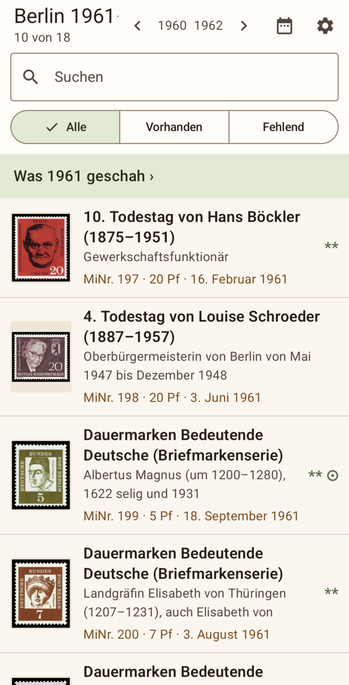
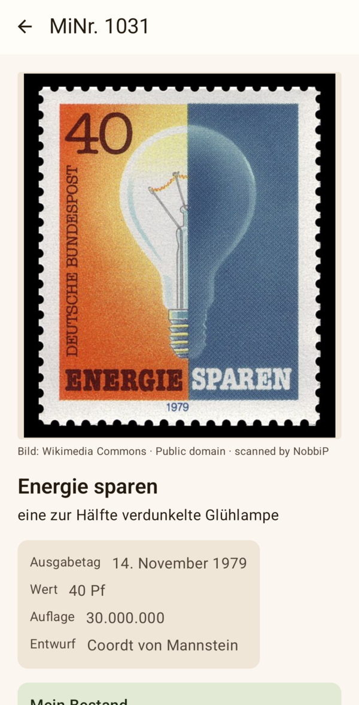
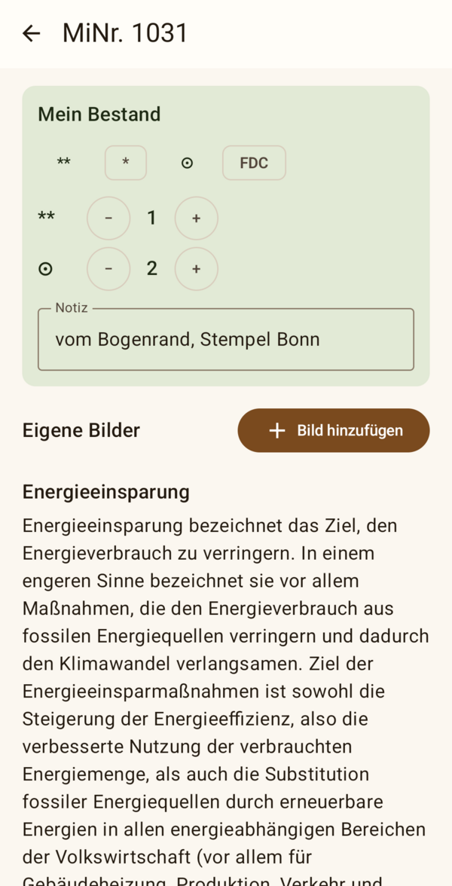
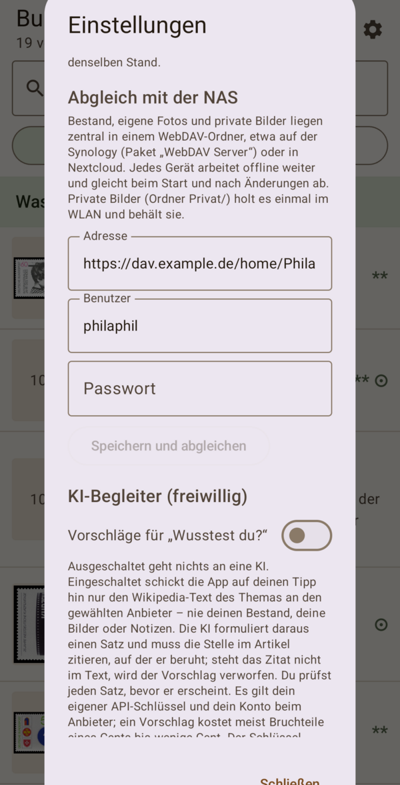

# Willkommen

PhilaPhil, Freund der Philatelie, lässt Briefmarken erzählen. Jede Marke steht für etwas: ein Ereignis, eine Person, eine Zeit. Die App nimmt dich mit in das Jahr der Herausgabe und in das Thema der Marke.

Ein Beispiel: „Energie sparen“ (MiNr. 1031) erschien im November 1979, mitten in der zweiten Ölkrise. Im selben Jahrgang stehen Albert Einstein, Otto Hahn, die erste Direktwahl zum Europaparlament und Anne Frank zum 50. Geburtstag. Ein Jahrgang ist ein Zeitbild.

PhilaPhil ist **ein Katalog, der erzählt – kein Katalog, der bewertet**. Preise, Abarten und Spezialwissen findest du im MICHEL-Katalog; PhilaPhil sagt, *warum* es eine Marke gibt und was damals los war.

Was PhilaPhil enthält:

- **Bund** 1949 bis heute, **Berlin** 1948 bis 1990, **DDR** 1949 bis 1990 und **Deutsches Reich** 1872 bis 1945, zusammen fast 9000 Marken
- zu jeder Marke Anlass, Ausgabetag, Wert, Auflage und Entwurf, dazu das Thema in wenigen Sätzen aus der Wikipedia
- die Zeitreise durch die Jahrgänge und „Heute vor Jahren“
- deinen eigenen Bestand mit Erhaltung, Anzahl und Notiz, eigene Bilder und den Abgleich zwischen deinen Geräten

PhilaPhil ist kostenlos und quelloffen. Es gibt kein Konto, kein Abo, keine Werbung und keine Auswertung deiner Daten.

# Installation

PhilaPhil gibt es in drei Fassungen aus einer gemeinsamen Grundlage. Alle stehen auf der Download-Seite: <https://github.com/thobgg/philaphil/releases/latest>

| Fassung | Für | Datei |
|---|---|---|
| PhilaAnd | Android ab Version 8, Handy und Tablet | `PhilaAnd-1.0.apk` |
| PhilaWin | Windows 10 und 11 | `PhilaWin-1.0.….exe` |
| PhilaTux | Debian, Ubuntu, Linux Mint | `philatux_1.0-…_amd64.deb` |

**Android.** Lade die APK-Datei auf dem Gerät herunter und tippe sie an. Weil die App nicht aus dem Play Store kommt, fragt Android einmal, ob der Browser Apps installieren darf; erlaube das für diese Installation. Ein Update installierst du genauso, dein Bestand und deine Einstellungen bleiben dabei erhalten.

**Windows.** Starte die exe-Datei und folge dem Installer. Windows kann vor einem „unbekannten Herausgeber“ warnen; mit „Weitere Informationen“ und „Trotzdem ausführen“ geht es weiter.

**Linux.** Installiere das Paket im Terminal:

```
sudo apt install ./philatux_1.0-9_amd64.deb
```

Der Katalog ist in der App enthalten. Beim ersten Start braucht PhilaPhil kein Netz; nur die Bilder von Wikimedia Commons kommen nach und nach aus dem Internet.

# Der erste Blick

{width=45%}

Beim ersten Start zeigt PhilaPhil den Jahrgang Bund 1979. Oben steht der Titel des Jahrgangs, darunter die Suche und die drei Filter, dann die Liste der Marken.

- **Gebiet und Jahrgang wählen:** Tippe auf den Titel, etwa „Bund 1979 ▾“. Es öffnet sich die Auswahl mit allen Gebieten und Jahren. Die Besatzungszonen 1945 bis 1949 stehen als ein Eintrag; wählst du ihn, erscheint darunter eine zweite Reihe mit den dreizehn Gebieten jener Jahre: Gemeinschaftsausgaben des Alliierten Kontrollrats, Amerikanische und Britische Zone, die französische Zone mit Baden, Rheinland-Pfalz und Württemberg-Hohenzollern sowie die sowjetische Zone mit Berlin-Brandenburg, Mecklenburg-Vorpommern, Provinz Sachsen, Ost-Sachsen, West-Sachsen und Thüringen.
- **Blättern:** Die Pfeile neben den Jahreszahlen führen zum vorigen und nächsten Jahrgang desselben Gebiets.
- **Heute vor Jahren:** Das Kalendersymbol oben rechts.
- **Einstellungen:** Das Zahnrad oben rechts. Dort findest du auch „Hilfe und Anleitung“.

Am Tablet im Querformat und am PC steht links die Liste und rechts die gewählte Marke. Am Handy öffnet die Marke eine eigene Seite; mit der Zurück-Taste geht es zur Liste.

# Suchen und filtern

Das Suchfeld findet Marken über alle Gebiete und Jahre: nach dem Anlass („Olympische Spiele“), dem Motiv („Leuchtturm“), dem Thema („Albert Schweitzer“) oder der MiNr. („1031“). Löschst du die Eingabe, zeigt die Liste wieder den Jahrgang.

Die drei Knöpfe unter der Suche filtern nach deinem Bestand:

- **Alle** zeigt jede Marke.
- **Vorhanden** zeigt nur Marken, die du eingetragen hast.
- **Fehlend** zeigt die Lücken, praktisch auf der Börse oder beim Händler.

# Die Marke

{width=45%}

Ein Tipp auf eine Marke öffnet ihre Karte:

1. **Das Bild**, darunter Herkunft und Lizenz.
2. **Titel und Motiv.**
3. **Die Daten:** Ausgabetag, Wert, Auflage und Entwurf.
4. **Ganzer Satz** oder **Ganze Serie**, wenn die Marke zu einem Satz oder einer Dauermarkenserie gehört.
5. **Mein Bestand** und **Eigene Bilder** (siehe unten).
6. **Das Thema:** zwei, drei Sätze aus der Wikipedia, gelegentlich ein „Wusstest du?“, und der Weg zu allen anderen Marken mit diesem Thema.

**Weiterwischen.** Am Handy und Tablet wischst du auf der Karte nach links oder rechts zur nächsten oder vorigen Marke des Jahrgangs.

**Großes Bild.** Ein Tipp aufs Bild zeigt es bildschirmfüllend. Mit zwei Fingern vergrößerst du es, ein Doppeltipp zoomt hinein und wieder heraus, Wischen blättert durch die Marken.

**Ganzer Satz.** Die Tafel zeigt alle Werte eines Satzes nebeneinander wie auf einem Albumblatt, sortiert nach MiNr. oder Wert. Bei Dauermarkenserien wie „Frauen der deutschen Geschichte“ sind die Werte nach Jahren geordnet, oft über viele Jahrgänge. Was du schon hast, ist hervorgehoben.

**Themen.** Ein Thema führt zu allen Marken, die es berühren, über Gebiete und Jahrzehnte hinweg: Luftfahrt, Nobelpreisträger, Albert Schweitzer in der DDR und in der Bundesrepublik.

**Bund, Berlin, DDR, Deutsches Reich und die Besatzungszonen.** Die Karte ist in allen Gebieten gleich aufgebaut. In den Zonen hat jedes Gebiet seine eigene Zählung, die MiNr. 1 gibt es also in Baden, in Rheinland-Pfalz und in der Bizone; bei der Bizone zählt jeder Druck als eigene Marke (amerikanischer, englischer und deutscher Druck der M-Serie). Wie viele Angaben sie zeigt, hängt von den Wikipedia-Listen ab: Beim Deutschen Reich fehlt meist die Auflage, dafür gibt es dort besonders viele Bilder. Fehlt eine Angabe, lässt die Karte die Zeile weg. Die Zeitreise gehört zum Jahr, nicht zum Gebiet: Berlin 1961 und DDR 1961 erzählen dasselbe Jahr.

# Zeitreise und Heute vor Jahren

{width=45%}

**Was … geschah.** Über der Markenliste steht „Was 1979 geschah ›“. Die Seite erzählt das Jahr: eine kurze Einordnung und ausgewählte Ereignisse aus Politik, Kultur, Wissenschaft und Sport. Ereignisse mit Stern berühren das Thema einer Marke desselben Jahrgangs und führen direkt zu ihr. So blätterst du durch die Jahrzehnte wie durch ein Geschichtsbuch.

**Heute vor Jahren.** Das Kalendersymbol zeigt, wer an diesem Tag geboren wurde oder starb und was gegründet wurde, jeweils zu den Menschen und Dingen auf den Marken, dazu die Marken, die an diesem Tag erschienen. Mit den Pfeilen gehst du von Tag zu Tag.

# Dein Bestand

{width=45%}

Auf der Karte jeder Marke trägst du unter **Mein Bestand** ein, was du hast:

| Zeichen | Bedeutung |
|---|---|
| \*\* | postfrisch |
| \* | ungebraucht mit Falz |
| ⊙ | gestempelt |
| FDC | Ersttagsbrief |

Tippe eine Erhaltung an, um sie hinzuzufügen. Mit **−** und **+** änderst du die Anzahl; bei 0 ist der Eintrag wieder entfernt. Ins Feld **Notiz** schreibst du, was du dir merken willst: Herkunft, Stempelort, Zustand.

In der Liste stehen deine Erhaltungen neben jeder Marke, etwa „\*\* ⊙×2“. Oben steht, wie viele Marken des Jahrgangs du hast: „26 von 38 im Bestand“.

Der Bestand wird sofort gespeichert. Er liegt als lesbare Datei `bestand.json` im Sammlungsordner (siehe *Deine Daten*).

# Eigene Bilder

Unter **Eigene Bilder** fügst du einer Marke ein Bild hinzu:

- **Foto aufnehmen** mit der Kamera des Geräts,
- **Aus der Galerie wählen** oder
- **Datei wählen** am PC.

Das Bild wird auf höchstens 1600 Pixel verkleinert und im Sammlungsordner unter `Bilder` abgelegt, benannt nach Gebiet und MiNr.: `Bund-1031.jpg`, ein zweites Bild `Bund-1031-2.jpg`. Ein eigenes Bild gilt für jede Marke, ob du sie besitzt oder nicht, und geht vor jedem anderen Bild.

Du kannst Bilder auch selbst in den Ordner `Bilder` legen, etwa Scans vom PC. Achte auf die Namensregel und tippe danach in den Einstellungen auf **Neu einlesen**. Für Blöcke und Sonderzählungen steht ein Unterstrich statt des Leerzeichens: `Bund-Bl._16.jpg`.

Welches Bild PhilaPhil zeigt, folgt dieser Reihenfolge:

1. dein eigenes Bild,
2. ein privates Bild von deiner NAS (siehe *Private Bilder*),
3. das Bild von Wikimedia Commons,
4. ein Platzhalter mit der MiNr.

# Mehrere Geräte: Abgleich mit der NAS

Wer PhilaPhil auf Handy, Tablet und PC nutzt, möchte überall denselben Bestand sehen. Dafür gleicht PhilaPhil mit einem gemeinsamen Ordner auf einem WebDAV-Server ab, zum Beispiel auf einer Synology-NAS oder in einer Nextcloud.

**So funktioniert es.** Jedes Gerät arbeitet weiter mit seiner eigenen Kopie, auch ohne Netz. Der Abgleich läuft beim Start der App, ein paar Sekunden nach jeder Änderung und wenn du die App wieder öffnest. Dabei wird nicht die ganze Datei überschrieben, sondern jeder Eintrag einzeln zusammengeführt: Trägst du am Tablet Bund 1973 ein und am Handy Berlin 1980, kommt beides an. Entfernte Einträge werden ebenfalls weitergegeben.

Abgeglichen werden:

- der **Bestand** (`bestand.json`),
- deine **eigenen Bilder** (Ordner `Bilder`),
- die **privaten Bilder** (Ordner `Privat`, nur in eine Richtung: von der NAS aufs Gerät).

## Einrichten auf einer Synology-NAS

1. **WebDAV einschalten.** Im Paket-Zentrum das Paket **WebDAV Server** installieren. In seinen Einstellungen **HTTPS** aktivieren (Port 5006). HTTP kannst du ausgeschaltet lassen.
2. **Ordner anlegen.** In der File Station in deinem persönlichen Ordner (`home`) einen Ordner **PhilaPhil** anlegen. Voraussetzung ist, dass der Benutzer-Home-Dienst eingeschaltet ist (Systemsteuerung → Benutzer und Gruppe → Erweitert).
3. **Eigenen Benutzer anlegen (empfohlen).** Lege einen Benutzer an, etwa `philaphil`, der nur auf diesen Ordner zugreifen darf, und gib ihm das Recht für WebDAV (Systemsteuerung → Benutzer → Anwendungen). Dann kann ein verlorenes Handy nicht an deine übrigen Daten. In diesem Fall liegt der Ordner in dessen Home oder in einem eigenen freigegebenen Ordner.
4. **In der App eintragen.** Einstellungen → **Abgleich mit der NAS**:
   - Adresse: `https://<Adresse der NAS>:5006/home/PhilaPhil`
   - Benutzer und Passwort
   - **Speichern und abgleichen**

{width=45%}

**Die Frage nach dem Zertifikat.** Im Heimnetz sprichst du die NAS meist über ihre IP-Adresse an (`192.168.…`). Ihr Zertifikat lautet aber auf ihren Namen. PhilaPhil fragt dann einmal: „Die NAS meldet sich mit einem gültigen Zertifikat für … – vertrauen?“ Bestätige mit **Vertrauen**. Danach gilt dieses Zertifikat unter dieser Adresse, auch wenn es erneuert wird.

**Unterwegs abgleichen.** Von außen erreichst du die NAS am besten über einen Reverse Proxy mit eigenem Namen. Dann gilt eine Adresse zu Hause und unterwegs, und die Frage nach dem Zertifikat entfällt.

1. **Name:** Lass einen Namen wie `dav.example.de` auf deine NAS zeigen, so wie deine anderen Dienste. Hast du bei deinem Anbieter einen Platzhalter-Eintrag für alle Subdomains, ist das schon erledigt.
2. **Reverse Proxy:** Systemsteuerung → Anmeldeportal → Erweitert → Reverse Proxy → Erstellen.
   - Quelle: HTTPS, Hostname `dav.example.de`, Port 443
   - Ziel: **HTTPS**, Hostname `127.0.0.1`, Port 5006
3. **Zertifikat:** Systemsteuerung → Sicherheit → Zertifikat → **Einstellungen**. Dem Eintrag `dav.example.de` ein Zertifikat zuweisen, das diesen Namen enthält, etwa ein Platzhalter-Zertifikat `*.example.de` von Let's Encrypt.
4. **In der App:** Adresse `https://dav.example.de/home/PhilaPhil`.

## Einrichten mit Nextcloud

Lege in deiner Nextcloud einen Ordner **PhilaPhil** an. Die Adresse lautet:

```
https://<dein Server>/remote.php/dav/files/<Benutzername>/PhilaPhil
```

Nutzt du die Zwei-Faktor-Anmeldung, erstelle in den persönlichen Einstellungen unter *Sicherheit* ein **App-Passwort** und trage dieses statt deines Passworts ein.

## Was im Ordner liegt

| Datei oder Ordner | Inhalt |
|---|---|
| `bestand.json` | dein Bestand, lesbar in jedem Texteditor |
| `Bilder/` | deine eigenen Bilder |
| `Privat/` | private Bilder, nur für deine Geräte |
| `Sicherung/` | eine Kopie des Bestands je Tag, die letzten 30 Tage |

## Wenn zwei Geräte dieselbe Marke ändern

Änderst du dieselbe Marke in derselben Erhaltung auf zwei Geräten, bevor diese abgeglichen haben, gilt die spätere Änderung. Das kommt selten vor; meist hat ein Gerät schon abgeglichen, bevor du zum nächsten greifst. Achte darauf, dass auf allen Geräten Datum und Uhrzeit automatisch eingestellt sind.

Schreiben zwei Geräte im selben Augenblick, merkt PhilaPhil das, liest den neuen Stand, führt zusammen und schreibt erneut. Es geht nichts verloren.

## Sicherungen

Vor der ersten Änderung eines Tages legt PhilaPhil den bisherigen Stand im Ordner `Sicherung` ab, etwa `bestand-2026-10-17.json`. Die letzten 30 Tage bleiben erhalten. Die Dateien sind lesbar; einzelne Einträge kannst du daraus nachschlagen und in der App wieder eintragen.

## Abgleich ausschalten

**Trennen** in den Einstellungen vergisst Adresse und Zugang. Bestand und Bilder auf dem Gerät bleiben, ebenso alles auf der NAS.

# Private Bilder

Manche Bilder darfst du nur für dich selbst verwenden: Scans aus einem eigenen Archiv oder Bilder, die du für den privaten Gebrauch gespeichert hast. Sie gehören nicht in eine öffentliche App, sollen aber auf all deinen Geräten erscheinen. Dafür gibt es den Ordner `Privat` auf deiner NAS.

1. Lege die Bilder in den Ordner `Privat` im PhilaPhil-Ordner, benannt wie eigene Bilder: `Bund-1031.jpg`, `DDR-250.jpg`, `Berlin-42.jpg`.
2. Lege dazu eine Textdatei `quelle.txt` mit einer einzigen Zeile, die unter jedem dieser Bilder steht, zum Beispiel: `Bild: aus meinem Archiv, nur privat`.
3. Jedes Gerät holt die Bilder beim Abgleich **einmal** und behält sie dauerhaft. Am Handy geschieht das nur im WLAN; mit **Private Bilder auch ohne WLAN** holst du sie bei Bedarf über mobile Daten.

Ersetzt du ein Bild auf der NAS durch ein besseres, holen die Geräte es beim nächsten Abgleich neu. Entfernst du eines, verschwindet es auch auf den Geräten.

Private Bilder verlassen deine Geräte und deine NAS nicht. Nimm nur Bilder, die du privat nutzen darfst.

# Bilder für unterwegs

Die Bilder von Wikimedia Commons lädt PhilaPhil, sobald du sie ansiehst, und behält sie im Zwischenspeicher. Willst du auch ohne Netz überall Bilder sehen, tippe in den Einstellungen auf **Vorschaubilder laden**. PhilaPhil holt dann die kleinen Bilder aller Marken, etwa 40 MB, am Handy nur im WLAN. Die großen Bilder für die Vollansicht kommen weiter erst, wenn du sie öffnest.

# KI-Begleiter

Der KI-Begleiter ist freiwillig und ausgeschaltet, bis du ihn einschaltest. Er schlägt zu einem Thema einen Satz für „Wusstest du?“ vor.

- Du brauchst einen eigenen Schlüssel bei **Claude** (Anthropic), **ChatGPT** (OpenAI) oder **Gemini** (Google). Ein Vorschlag kostet dort meist Bruchteile eines Cents.
- Auf deinen Tipp hin schickt PhilaPhil nur den Wikipedia-Text des Themas an den Anbieter, nie deinen Bestand, deine Bilder oder Notizen.
- Die KI muss die Stelle im Artikel zitieren, auf der ihr Satz beruht. Steht das Zitat nicht im Text, wird der Vorschlag verworfen.
- Du prüfst jeden Satz, bevor er erscheint. Freigegebene Sätze liegen in `wusstest_du.json` im Sammlungsordner.

# Deine Daten

PhilaPhil hat kein Konto, kein Abo, keine Werbung und keine Auswertung. Alles, was du einträgst, gehört dir und liegt in offenen Formaten:

- **Sammlungsordner:** `bestand.json` (Bestand), `Bilder/` (eigene Bilder) und `wusstest_du.json` (deine Sätze). Den Ordner wählst du in den Einstellungen; am Handy liegt er sonst im App-Speicher.
- **Auf deiner NAS**, wenn du den Abgleich nutzt: dieselben Dateien, dazu `Privat/` und `Sicherung/`.

Ins Internet gehen nur:

- Abrufe bei Wikipedia und Wikimedia Commons (Bilder und Lizenzangaben),
- der Abgleich mit deiner eigenen NAS,
- der KI-Begleiter, wenn du ihn eingeschaltet hast und ihn antippst.

Ein Eintrag in `bestand.json` sieht so aus:

```json
{
    "gebiet": "Bund",
    "mi_nr": "1031",
    "erhaltung": "**",
    "anzahl": 1,
    "notiz": "vom Bogenrand",
    "geaendert": "2026-10-17T08:30:00Z"
}
```

Steht `anzahl` auf 0, wurde der Eintrag entfernt; der Vermerk sorgt dafür, dass die anderen Geräte ihn auch entfernen.

# Wenn etwas nicht klappt

**„NAS nicht erreichbar“.** Das Gerät ist nicht im Heimnetz, oder die NAS ist von außen nicht erreichbar. PhilaPhil arbeitet weiter und gleicht ab, sobald die NAS wieder da ist.

**„Benutzer oder Passwort falsch“.** Prüfe die Angaben. Bei Synology braucht der Benutzer das Recht für WebDAV, bei Nextcloud mit Zwei-Faktor-Anmeldung ein App-Passwort.

**„Ordner nicht gefunden“.** Der Ordner in der Adresse fehlt oder ist falsch geschrieben. Groß- und Kleinschreibung zählen.

**„Rückfrage zum Zertifikat“.** Öffne die Einstellungen; dort erscheint die Frage, ob du dem Zertifikat vertraust.

**Private Bilder fehlen am Handy.** Die Meldung lautet dann „… private Bilder warten aufs WLAN“. Verbinde dich mit dem WLAN und tippe auf **Jetzt abgleichen**.

**Ein eigenes Bild erscheint nicht.** Prüfe den Dateinamen (`Bund-1031.jpg`) und tippe in den Einstellungen auf **Neu einlesen**.

**Eine Marke fehlt oder hat falsche Daten.** Die Daten kommen aus den Jahrgangslisten der Wikipedia. Schreib mir gern, dann korrigiere ich es im Katalog.

# Quellen und Lizenzen

- **Marken und Themen:** Jahrgangslisten und Artikel der deutschsprachigen Wikipedia, Lizenz CC BY-SA 4.0. Die App nennt bei jedem Text die Quelle.
- **Bilder:** Wikimedia Commons, Lizenz und Urheber stehen unter jedem Bild.
- **Lebens- und Ereignisdaten:** Wikidata (CC0) und die Jahresartikel der Wikipedia.
- **Die App** ist freie Software unter der GPL-3.0, der Katalog steht unter CC BY-SA 4.0. Quelltext: <https://github.com/thobgg/philaphil>

Der Name MICHEL ist eine eingetragene Marke. PhilaPhil übernimmt nichts aus dem MICHEL-Katalog und ist kein Ersatz dafür.

# Kontakt

Fehler, Wünsche und Ergänzungen gern per Mail an <thomas@bgg-mail.de> oder als Issue auf GitHub: <https://github.com/thobgg/philaphil/issues>

Webseite: <https://philaphil.bgg-home.de/>
